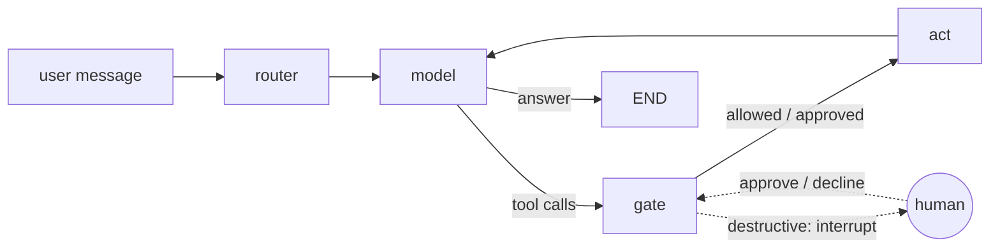

# Agents

`quaerium.agents` is a small agent runtime: a LangGraph loop around the Anthropic
SDK, with tools you write as plain async functions and a policy gate that stops
before anything hard to undo — and keeps waiting across restarts.

```bash
pip install "quaerium[agents]"                  # the kernel
pip install "quaerium[agents-postgres,server]"  # durable approvals + HTTP layer
```



The loop is deliberately small. LangGraph is there for two things: the
**checkpointer**, which writes every step to Postgres, and **`interrupt`**, which
lets the gate stop a run and resume it minutes later — from a different process.

## Tools

A tool is an async function with a namespace and a risk level. The JSON Schema
the model sees is derived from the signature and the Google-style docstring.

```python
from quaerium.agents import RiskLevel, tool

@tool(namespace="tickets", risk=RiskLevel.READ)
async def search(text: str, status: Literal["open", "closed"] = "open") -> str:
    """Find support tickets.

    Args:
        text: Words to look for in the title.
        status: Which tickets to search.
    """
    return "..."

search.name          # "tickets__search"
await search(text="refund")   # still callable directly, in tests
```

Tools return **text** for the model. They should not raise for expected
failures; if they do, the registry turns the exception into an error result the
model can read and recover from, instead of killing the run.

| Risk | Default policy | Meant for |
|---|---|---|
| `READ` | runs | no side effects |
| `WRITE` | runs | a side effect that is easy to see and undo |
| `DESTRUCTIVE` | **asks** | anything hard to reverse |

An unknown tool name is treated as `DESTRUCTIVE`: the registry fails closed.

Collect tools in a registry:

```python
from quaerium.agents import ToolRegistry

registry = ToolRegistry()
registry.register_many([search, close])
```

### Clients behind tools

`ClientProvider` decides once per process whether a capability gets its real
client, an offline fake, or a configuration error that names what is missing.
It knows nothing about your settings class — you hand it a getter:

```python
from quaerium.agents import ClientProvider

argocd = ClientProvider(
    name="argocd",
    settings=get_settings,
    real=lambda s: ArgoCDClient(s.argocd_url, s.argocd_token),
    fake=FakeArgoCDClient,                 # optional
    use_fake=lambda s: s.fake_tools,
    requires=lambda s: [] if s.argocd_token else ["APP_ARGOCD_TOKEN"],
)
```

`provider.set(instance)` injects a client (from the app's lifespan, or a test).

### RAG as a tool

```python
from quaerium.agents import graph_query_tool, rag_tool

registry.register_many([
    rag_tool(pipeline, namespace="kb", description="The support handbook."),
    graph_query_tool(neo4j, namespace="kb", description="(:Doc)-[:CITES]->(:Doc)"),
])
```

`rag_tool` runs the (synchronous) pipeline in a worker thread and returns the
answer with numbered sources. `graph_query_tool` is read-only by default: write
clauses are rejected before they reach the store. With `read_only=False` it
becomes `DESTRUCTIVE`, so every query waits for a human.

## The policy gate

```python
from quaerium.agents import PolicyGate, RiskLevel

policy = PolicyGate(
    why={  # shown verbatim in the confirmation dialog — use the user's language
        RiskLevel.DESTRUCTIVE: "Modifica o elimina dati già registrati: serve la tua conferma.",
    },
    confirm_writes=False,     # True: writes ask too
    block_destructive=False,  # True: refuse instead of asking (unattended runs)
)
```

A declined call still produces a `tool_result` for the model, phrased as an
outcome ("Not executed. The user declined this action."), so it reports back
instead of looking for another way.

## The graph

```python
from quaerium.agents import AnthropicLLM, build_graph

llm = AnthropicLLM(api_key=key, model="claude-sonnet-5", risk_of=registry.risk_of)

graph = build_graph(
    llm=llm,
    registry=registry,
    system=SYSTEM_BLOCKS,          # static, built once, cached by the API
    context=build_context,         # async () -> block | None, rebuilt every turn
    classify=classify,             # your router heuristic: str -> route | None
    router_llm=cheap_llm,          # only for messages classify() can't place
    effort="high",
    effort_for_route={"chitchat": "low", "question": "medium"},
    max_steps=12,
    policy=policy,
    checkpointer=saver,
    **audit.hooks(),
)
```

**System prompt.** `system` is the static part — mark it with `cache_control`.
`context` is appended after it on every turn (today's date, the user's
categories), so changing it never invalidates the cached prefix.

**Routing.** Each message is classified as `chitchat` (no tools, low effort),
`question` or `action`. `classify` is your vocabulary — regexes are usually
enough; return `None` when unsure and the cheap model decides, or the message is
treated as a `question`.

**Models.** `AnthropicLLM` sends Claude adaptive thinking, effort and the
server-side refusal fallback. With `gateway_url` (a LiteLLM proxy) any other
model — `local/*` on Ollama, say — gets the portable subset of the request, and
Claude's signed thinking blocks are kept out of its history.

## Running it

```python
from quaerium.agents import AgentRunner

runner = AgentRunner(graph=graph, sessions=sessions, audit=audit)

async for event in runner.start(session_id, "close T-1"):
    ...   # thinking, token, tool_call, tool_result, then exactly one of:
          # done | approval_required | error

async for event in runner.resume(session_id, run_id, approved=True):
    ...
```

The session id is the checkpointer thread, so history accumulates by itself.
`runner.pending_approval(session_id)` lets a UI restore a pending dialog after a
reload.

## Persistence

| Piece | Without config | With config | Extra |
|---|---|---|---|
| `checkpointer(dsn)` | in memory: a restart forgets waiting runs | Postgres | `agents-postgres` |
| `build_session_store(redis_url, prefix=...)` | in memory | Redis, keys `{prefix}:session:{id}` | `agents-redis` |
| `build_audit_log(dsn, table_prefix=...)` | in memory | Postgres, tables `{prefix}_runs`, … | `agents-postgres` |

Both prefixes let an app keep the data it wrote before adopting the kernel.

### Migrating checkpoints

LangGraph stores objects with their module path. If your app had its own copy of
these types (`myapp.core.types.ToolCall`), a run suspended before the switch
references that path. Pass it as `legacy_modules` and it loads as the kernel
type:

```python
async with checkpointer(dsn, legacy_modules=["myapp.core.types"]) as saver:
    ...
```

## HTTP layer

```python
from quaerium.agents.server import make_approvals_router, make_runs_router, stream

app.include_router(make_approvals_router(get_services))   # GET/POST /api/approvals
app.include_router(make_runs_router(get_services))        # GET /api/runs[/{id}]

@app.post("/api/chat")
async def chat(body: ChatRequest, svc = Depends(get_services)):
    return stream(svc.runner.start(body.session_id, body.message))
```

`get_services` returns any object with `runner`, `audit` and `durable`. The chat
endpoint stays in the app: validating the message and picking the model are the
app's business.

## Testing

`ScriptedLLM` replays a list of turns, so tests assert on what the loop does —
not on what a model happened to say — with no key and no network:

```python
from quaerium.agents.testing import ScriptedLLM

llm = ScriptedLLM([
    ScriptedLLM.call("tickets__close", {"ticket_id": "T-1"}, risk=RiskLevel.DESTRUCTIVE),
    ScriptedLLM.say("Closed."),
])
...
assert llm.requests[0]["tools"] is not None
```

See [`examples/agent_rag_example.py`](https://github.com/gmottola00/quaerium/blob/main/examples/agent_rag_example.py)
for a complete run, approval included, that works offline.
