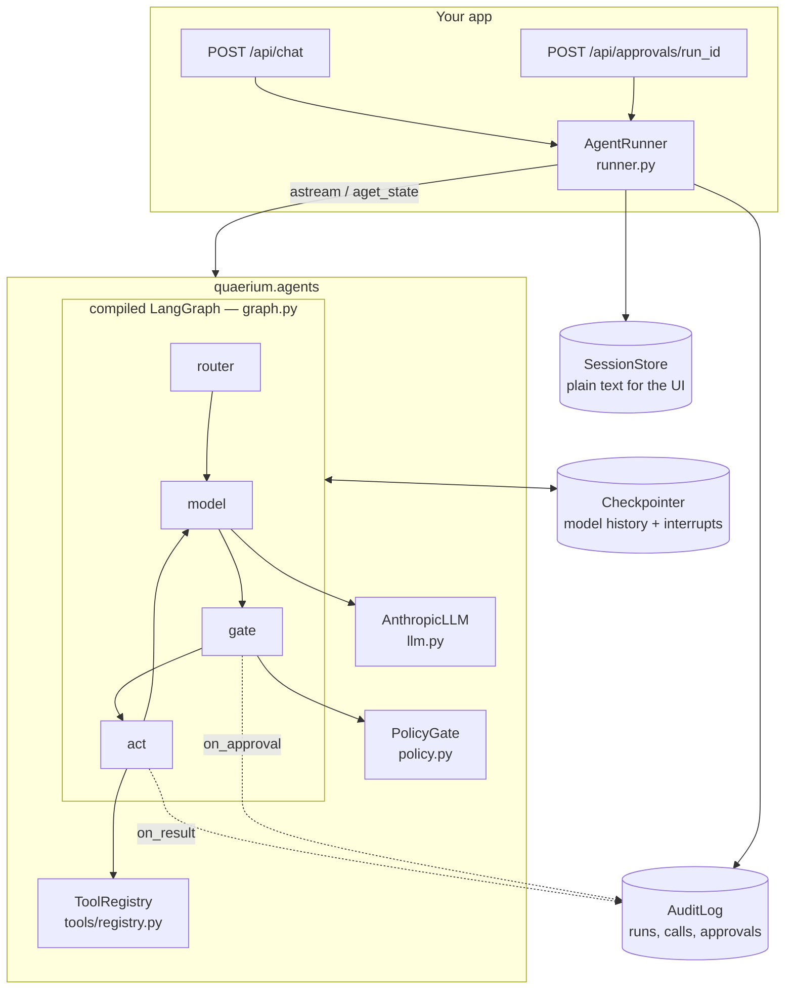
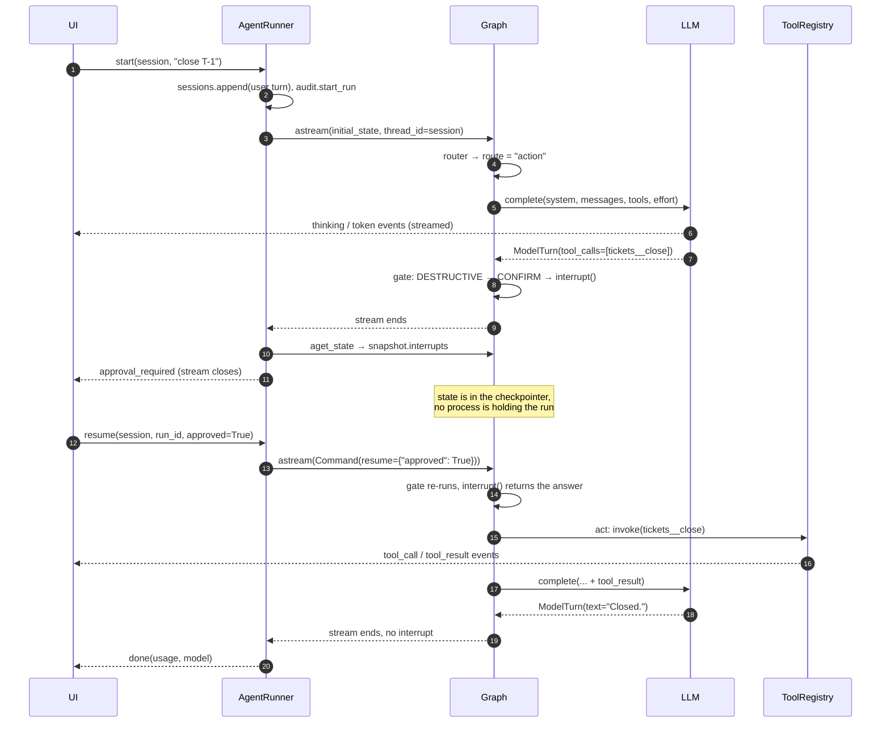
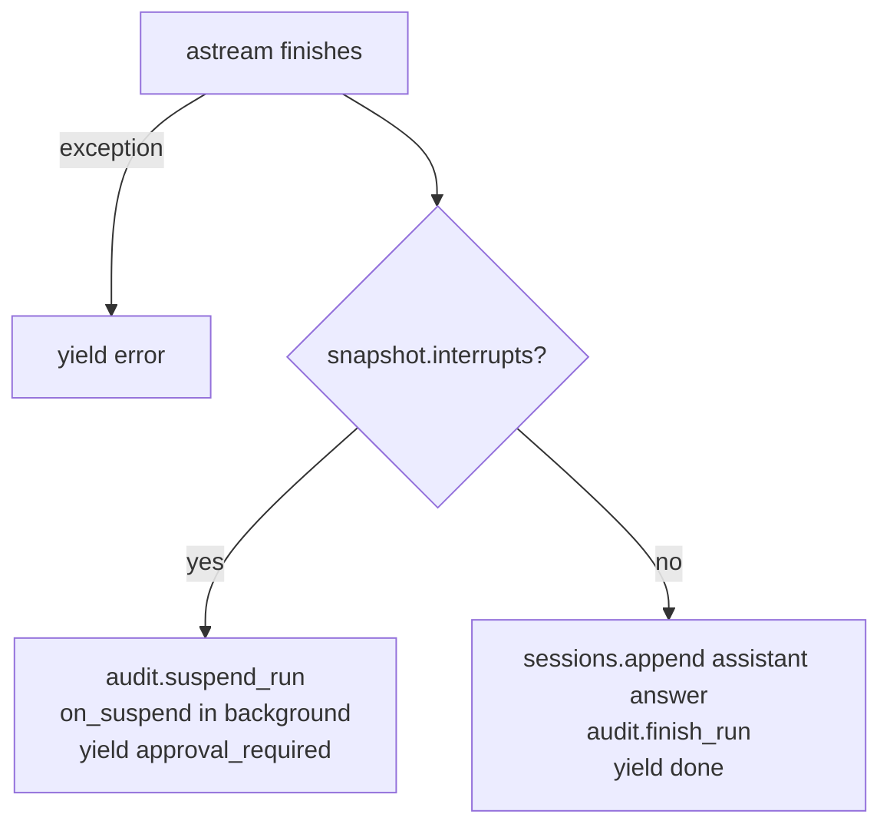
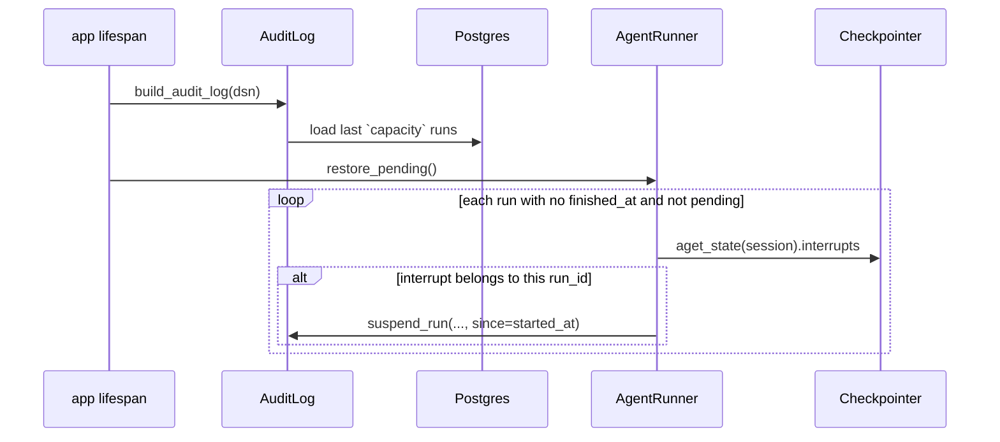

# How agents work

The [Agents guide](agents.md) shows how to *use* `quaerium.agents`. This page
follows one run through the kernel, piece by piece: what is in the state, what
each node does with it, how a run stops at the gate and comes back, and which
store knows what.

Everything here is read from `src/quaerium/agents/`; file names are given so you
can check.

## The pieces at a glance

| Module | Role |
|---|---|
| `graph.py` | Wires the four nodes and compiles them with a checkpointer. |
| `state.py` | `AgentState`, the only thing that travels between nodes. |
| `nodes/router.py` | Picks a route: `chitchat`, `question`, `action`. |
| `nodes/model.py` | Calls the model once, puts its turn into state. |
| `nodes/gate.py` | Splits the requested tool calls into *run* and *refused*; suspends when a human must decide. |
| `nodes/act.py` | Runs the cleared calls in parallel, returns all results in one message. |
| `runner.py` | Drives the graph and decides how a run *ended*. |
| `llm.py` | The only place a model is called. |
| `events.py` | Pushes `RunEvent`s into LangGraph's custom stream. |

## The state

`AgentState` (`state.py`) is a `TypedDict`. Each node receives the whole state
and returns only the keys it changes; LangGraph merges the update. Two keys have
a **reducer** instead of being overwritten:

| Key | Merge | Written by | Meaning |
|---|---|---|---|
| `messages` | **append** | model, act | Conversation in raw Anthropic wire format. |
| `usage` | **sum** | model | Tokens, accumulated across every turn of the *session*. |
| `route` | replace | router | `chitchat` / `question` / `action`. |
| `pending` | replace | model, gate | Tool calls the model asked for, not yet ruled on. |
| `approved` | replace | gate, act | Calls cleared to run. |
| `denied` | replace | gate, act | Synthetic `ToolResult`s for calls that will not run. |
| `steps` | replace | model | Model turns in this run. |
| `answer`, `error` | replace | model | Final text, and `refusal` / `max_steps` when it ended abnormally. |
| `model`, `served_by` | replace | runner, model | Model requested vs model that actually answered. |

Messages are kept as plain dicts, not framework message classes, because they go
back to the API **byte-identical** on the next request — thinking blocks must be
echoed unchanged or the API rejects them.

### How history accumulates

The checkpointer thread id **is the session id** (`AgentRunner._config`). When a
new run starts, the runner passes `initial_state(...)` as the graph input. Against
an existing thread that input is *merged* into the stored state:

- `messages=[{"role": "user", ...}]` goes through the append reducer, so the new
  message lands after the whole previous conversation;
- `usage=Usage()` is added to the stored total — a no-op;
- everything else (`steps=0`, `pending=[]`, `answer=""`, a fresh `run_id`, …) is
  overwritten, which resets the per-run fields.

That is why there is no explicit "load history" step: the model always sees the
full session, and why `usage` in state is cumulative and the runner has to
compute a per-run delta (see [Ending a run](#ending-a-run)).

## One run, step by step

### 1. Router

`nodes/router.py`. Reads the **last user message whose content is a string**
(tool results are lists, so they are skipped) and decides how much machinery the
turn deserves:

1. `classify(text)` — your heuristic, free. A value outside `ROUTES` is logged as
   `router.bad_route` and treated as `None`.
2. If still `None` and a `router_llm` was given: one call with
   `DEFAULT_ROUTER_SYSTEM` (or `router_system`), `effort="low"`, no tools, nothing
   streamed. The reply is lower-cased and stripped of `` . ` ``; anything that is
   not exactly a route name is ignored.
3. Fallback: `question`.

The router runs **once per run**, not per model turn.

### 2. Model

`nodes/model.py`. One model turn per visit.

1. **Step ceiling.** If `steps >= max_steps`, no model call: the node sets
   `answer = max_steps_message`, `error = "max_steps"`, `pending = []`, and the
   run ends.
2. **Tools.** `chitchat` gets `tools=None`; every other route gets
   `registry.to_anthropic()`. That list is sorted by name, so it serialises
   identically every turn — an unstable tool list would silently break the prompt
   cache.
3. **System prompt.** `system` (static, built once — put `cache_control` on it)
   followed by the block returned by `await context()`, if any. The volatile part
   comes *after* the cached prefix, so changing it never invalidates the cache.
4. **Effort.** `effort_for_route.get(route, effort)`. The default map only
   lowers `chitchat`.
5. **Call.** `llm.complete(...)`, with an `emit` callback that turns streamed
   deltas into `thinking` and `token` events.
6. **Update.** The assistant's raw content goes into `messages`;
   `turn.tool_calls` into `pending`; `steps + 1`; the turn's usage; `served_by`.
   - `stop_reason == "refusal"` → `answer = turn.refusal`, `error = "refusal"`,
     `pending = []`.
   - no tool calls → `answer = turn.text`.

Then the conditional edge `after_model`: **non-empty `pending` → gate, else END.**

### 3. Gate

`nodes/gate.py`. For each pending call, `policy.decide(call.risk)` returns a
`Ruling(decision, why)`:

| Risk | default | `confirm_writes=True` | `block_destructive=True` |
|---|---|---|---|
| `READ` | ALLOW | ALLOW | ALLOW |
| `WRITE` | ALLOW | **CONFIRM** (`confirm_text`) | ALLOW |
| `DESTRUCTIVE` | **CONFIRM** | **CONFIRM** | **DENY** (`deny_text`) |

- **ALLOW** → into `approved`.
- **DENY** → into `denied` as a `ToolResult(ok=False)` whose content is
  *"Not executed. {why} Do not attempt this action another way; report it to the
  user."* — phrased as an outcome so the model reports it instead of working
  around it.
- **CONFIRM** → `interrupt({run_id, tool, args, risk, why})`.

Where does `call.risk` come from? `AnthropicLLM` stamps it when it parses the
model's `tool_use` blocks, using the `risk_of` callable you passed (usually
`registry.risk_of`). An unknown tool name, or an `AnthropicLLM` built without
`risk_of`, gives `DESTRUCTIVE`: the kernel fails closed.

#### What `interrupt` really does

`interrupt()` raises inside the node. LangGraph catches it, **writes a checkpoint**
with the interrupt payload attached, and ends the stream. No coroutine is left
waiting: the run exists only as a row in the checkpointer.

On resume (`Command(resume={"approved": ...})`), LangGraph runs the **gate node
again from the top**. This time `interrupt()` does not raise; it returns the
resume value. That has consequences that shape the code:

- The `approval_required` event is emitted by the **runner** from the
  checkpointed interrupt, not by the gate — emitted in the gate it would fire
  again on every resume.
- Calls ruled ALLOW/DENY before the interrupt are ruled again on resume. That is
  harmless: `decide()` is pure and the node only returns its update at the end.
- With **several** CONFIRM calls in one model turn, each resume answers one
  interrupt and the next one suspends the run again. The user sees one dialog per
  call. Because the node re-runs from the top, `on_approval` for the calls already
  answered is invoked again on each later resume, so with the default audit hooks
  those approvals can be recorded more than once.

The answer is read as `answer.get("approved")` for a dict, `bool(answer)`
otherwise. A grant moves the call to `approved`; a decline produces a refused
result with *"The user declined this action."*. Either way an `Approval` is
passed to `on_approval`.

The gate always leaves `pending = []`.

### 4. Act

`nodes/act.py`.

1. Emits a `tool_call` event per approved call.
2. Runs them **concurrently** in an `asyncio.TaskGroup`. `registry.invoke` never
   raises (see below), so one failing tool cannot cancel its siblings.
3. Emits a `tool_result` event per result (`summary` = first line, max 200
   chars) and calls `on_result(call, result)`.
4. Returns **one** user message holding every `tool_result` block — executed
   results first, then the refused ones — and clears `approved` / `denied`.

Two invariants live here:

- **Every `tool_use` id gets an answer.** Refused calls still produce a
  `tool_result` (with `is_error: true`), otherwise the next request is malformed.
- **All results in one message.** Splitting them across messages teaches the
  model to stop asking for parallel calls.

Then `act → model`, and the loop continues.

## Tools, inside

`tools/base.py`. `@tool(namespace=..., risk=...)` turns an async function into a
frozen `ToolSpec`:

- **Name**: `f"{namespace}__{fn.__name__}"`. Double underscore, because the API
  only accepts `^[a-zA-Z0-9_-]{1,128}$`.
- **Description**: the docstring summary (everything before `Args:`).
- **Schema**: built from the signature and `typing.get_type_hints`.

| Annotation | JSON Schema |
|---|---|
| `str`, `int`, `float`, `bool` | `string`, `integer`, `number`, `boolean` |
| `list[X]`, `set[X]`, `tuple[X, ...]` | `array` of `X` |
| `dict[...]` | `object` |
| `Literal["a", "b"]` | `enum` (typed if all choices share a type) |
| `X \| None` | `X` — optionality is "not in `required`", never a null type |
| missing / `Any` / anything else | `string` |

A parameter is `required` only when it has no default. A non-`None` default is
copied into the schema. `additionalProperties` is always `false`. Parameter
descriptions come from the `Args:` section (continuation lines are joined).

`ToolSpec.run(call_id, args)` **never raises**:

| Outcome | `ok` | content |
|---|---|---|
| returns text | `True` | the text, or `(no output)` if empty |
| `TypeError` | `False` | `Error: invalid arguments for {name}: …` |
| any other exception | `False` | `Error: {ExcType}: {message}` |

Note that a `TypeError` raised *inside* the tool is reported as invalid
arguments too. `ToolRegistry.invoke` adds one more case: an unknown name returns
`Error: no tool named '…'; have …` instead of raising `ToolNotFoundError`.
Calling the spec directly (`await spec(**kwargs)`) bypasses all of this — useful
in tests.

`rag_tool` wraps a synchronous pipeline in a worker thread and is always `READ`.
`graph_query_tool` rejects Cypher matching `CREATE|MERGE|DELETE|DETACH|SET|
REMOVE|DROP|LOAD CSV|FOREACH` or a `CALL` to anything outside `db.*` while
`read_only=True`; with `read_only=False` the check is gone and the tool becomes
`DESTRUCTIVE`.

## The model boundary

`llm.py`. The graph only knows the `LLM` protocol (`complete(...) -> ModelTurn`),
which is what lets `ScriptedLLM` replace it in tests.

`AnthropicLLM` keeps two SDK clients:

| Model id | Client | Request |
|---|---|---|
| `claude-*` | direct, or `{gateway_url}/anthropic` (LiteLLM pass-through) | full: adaptive thinking (`display: summarized`), `output_config.effort`, server-side refusal fallback beta |
| anything else | `{gateway_url}` (`/v1/messages`) | portable subset: `max_tokens` capped at 8192, thinking blocks stripped from history |

A non-Claude model without `gateway_url` raises `ConfigurationError`.

Streaming: only `content_block_delta` events are forwarded — `thinking_delta` as
`thinking`, `text_delta` as `token`. After the stream:

- `served_by` comes from LiteLLM's `x-litellm-model-group` header (it differs from
  the requested model after a gateway fallback), or the requested model.
- Blocks are dumped with `exclude_none` and without `parsed_output`, because the
  API rejects SDK-only fields when they are echoed back.
- For non-Claude models, thinking blocks are dropped from the stored content —
  a later Claude turn would reject a thinking block it did not sign. If that
  leaves nothing, the content becomes `(empty reply)` so the next request stays
  valid.
- On `stop_reason == "refusal"`, `refusal` is `stop_details.explanation` (or a
  generic sentence).

## Events

`events.py`. Nodes publish through LangGraph's **custom stream**:
`get_stream_writer()` inside a run, a no-op sink outside one (unit tests). Every
emit is wrapped so a failing sink only logs `events.emit_failed`.

The runner iterates `graph.astream(..., stream_mode="custom")`, so what reaches
the client is exactly what the nodes emitted, as `model_dump(mode="json")` dicts.

| Event | Emitted by | When |
|---|---|---|
| `thinking`, `token` | model node, via `emit` | while the model streams |
| `tool_call` | act | before running approved calls |
| `tool_result` | act | after each call |
| `approval_required` | **runner** | run stopped at the gate |
| `done` | **runner** | run finished |
| `error` | **runner** / SSE wrapper | exception |
| `model_unavailable` | your app (optional) | before any run starts |

A stream always ends with exactly one of `done`, `approval_required`, `error`.
Refused or declined calls do **not** emit `tool_call`/`tool_result`; they only
reach the model.

`server/sse.py` maps each event to an SSE message whose `event` name is the
`type` field, with a 15 s ping. An exception while streaming becomes a final
`error` event instead of a dropped socket.

## Ending a run

`AgentRunner._drain` (`runner.py`) streams one graph invocation, then decides how
it ended:

- **Usage.** State usage is cumulative per session, so `start()` reads it before
  the run and `done` carries `after - before`. `resume()` takes `before` from the
  suspended snapshot, so `done` after a resume covers only the continuation.
- **Model.** `done.model` is `served_by`; `done.requested_model` is the model
  passed to `start()`.
- **`on_suspend`** runs as a background task; the runner keeps a reference until
  it finishes, logs its exceptions (`run.on_suspend_failed`), and `aclose()`
  waits for the ones still in flight.
- **`resume()`** first checks `snapshot.interrupts`; if nothing is waiting it
  yields `error: "Nothing is waiting for approval in this session."` and stops.
  Because the checkpointer is keyed by **session**, a session has at most one
  run waiting at a time.
- **Logging context.** `start()`/`resume()` bind `run_id` and `session` to
  structlog contextvars for the whole run. The audit `on_result` hook reads the
  run id from there, since `ToolResult` does not carry one.

## Three stores, three questions

The kernel deliberately keeps three records of a conversation, because they
answer different questions and have different lifetimes.

| Store | Knows | Read by | Lifetime |
|---|---|---|---|
| **Checkpointer** (`checkpointer.py`) | Full model history, thinking blocks included; whether a run is suspended and on what | the graph, `resume`, `pending_approval`, `history` | Postgres, or memory |
| **SessionStore** (`memory.py`) | Plain user/assistant text, session list with titles | your UI sidebar | Redis with TTL (default 24 h, 200 turns), or memory |
| **AuditLog** (`audit.py`) | Per run: prompt, every executed call with args/outcome/duration, every decision, answer, usage | `/api/runs`, `/api/approvals` | memory ring of `capacity` runs, mirrored to Postgres |

Some consequences:

- The audit log is **write-through and best-effort**: reads always come from
  memory, Postgres writes that fail are logged, never raised.
- "Which runs are waiting" is **not** in the audit tables — only the in-memory
  `pending` flag, set by `suspend_run` and cleared by the next
  `record_approval`. The truth is the checkpointer.
- The checkpointer serializer is an **allowlist** (`CHECKPOINT_TYPES`: `RiskLevel`,
  `Decision`, `ToolCall`, `ToolResult`, `Approval`, `Turn`, `Usage`). App types you
  put into state must be passed as `extra_types`. Types are stored with their
  module path, which is why moving them needs `legacy_modules`.

### After a restart

A run with no `finished_at` either stopped at the gate or crashed; only the
checkpointer can tell them apart. `restore_pending()` does not call `on_suspend`
(nobody new is waiting), skips sessions whose checkpoint cannot be read, and
returns how many runs it marked.

With an **in-memory** checkpointer none of this survives: the run is gone and
`GET /api/approvals` reports `durable: false` so the UI can say so.

## Failure modes

| Situation | What happens |
|---|---|
| Tool raises | `ok=False` result with the exception text; the model sees it and can recover. |
| Model asks for an unknown tool | Risk `DESTRUCTIVE` → the gate asks a human; if approved, the registry returns an error result. |
| Model refuses | `answer` = refusal explanation, `error="refusal"`, run ends with `done`. |
| Loop does not converge | After `max_steps` model turns: `answer` = `max_steps_message`, `error="max_steps"`, `done`. |
| Exception in a node / the API | Stream ends with `error: "{ExcType}: {message}"`; no `finish_run`, so the run stays unfinished in the audit log. |
| User declines | Refused `tool_result`; the model is told not to try another way and reports back. |
| Event sink breaks | Logged, run continues. |
| `on_suspend` breaks | Logged, run unaffected. |
| Postgres audit write fails | Logged, memory still has the record. |
| Postgres extra not installed | `checkpointer()` logs `checkpointer.postgres_missing` and falls back to memory. |

## Where to go next

- [Agents guide](agents.md) — the public API, with examples.
- [Agents API reference](../api/agents/index.md) — every signature.
- [`examples/agent_rag_example.py`](https://github.com/gmottola00/quaerium/blob/main/examples/agent_rag_example.py) — a complete offline run, approval included.
